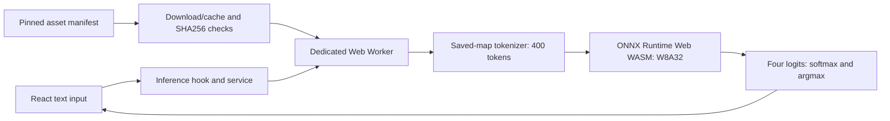

# AI-Generated Text Detection and Classification System for Thai-English Code-switching

A CS403 final-year Computer Science project at Thammasat University. The system fine-tunes WangchanBERTa to classify Thai text as **Human, GPT, Gemini or Other**, and runs the selected ONNX classifier in a browser Web Worker.

The finalized **W8A32** model achieved **87.3705% test Macro F1** and **97.3624% Human Precision** on the project's original 3,844-example test split. The corpus is **Thai-dominant news**. Supplementary Thai/Latin script-mixing analysis is exploratory; the project does **not** establish a fully annotated linguistic Thai-English code-switching benchmark.

**Source and deployment distinction:** this documentation describes the corrected `fix/model-inference` implementation. As verified on 9 November 2026, GitHub `main` still contains the older inference pipeline. The ordinary application source also retains legacy feedback/admin operations. The previously tested protected inference-only Preview was built from a separately isolated copy; a normal `npm run build` does not reproduce those security exclusions. Do not deploy the unrestricted source against a live backend before a separate security review.

## 1. Academic context and objectives

CS403 extends the earlier CS303/SP1 prototype to four-class source attribution, a balanced news corpus, group-based splitting and browser-side inference. The stated accuracy objectives are test Macro F1 ≥85% and Human Precision ≥95%. Engineering objectives include reproducible tokenization, verified model assets, responsive worker-based inference, optional caching and recovery from initialization/download failures.

These are results for a fixed model and evaluated data distribution, not proof of authorship or a general-purpose forensic detector.

## 2. Features and prediction outputs

- Four-class verdict, four softmax probabilities and combined AI score `1 − P(Human)`.
- Thai-focused text entry, loading progress, error messages, retry and light/dark themes.
- Dedicated worker, SHA256-pinned model/tokenizer assets, optional Cache API persistence and serialized inference requests.
- Existing feedback and admin screens are historical application features with deferred security work; they are not required for classification and were disabled in the reviewed staging copy.

| ID | Label | Meaning in this dataset |
|---:|---|---|
| 0 | Human | Text collected from the designated human news sources |
| 1 | GPT | `gpt-4o-mini` generations |
| 2 | Gemini | `gemini-2.5-flash-lite` generations |
| 3 | Other | Included DeepSeek/Qwen generations: `deepseek/deepseek-chat` and `qwen/qwen-2.5-7b-instruct` |

**Other is a trained class, not an unknown-model detector.** Softmax scores are not calibrated confidence guarantees. Never use a verdict alone to accuse a writer of misconduct.

## 3. Technology stack

| Component | Implementation |
|---|---|
| Frontend | React 19, TypeScript 6, Vite 8, Tailwind CSS 4 |
| Browser inference | `onnxruntime-web` **1.26.0-dev.20260416-b7804b056c**, WASM, one thread |
| Browser tokenizer | `@huggingface/tokenizers` **0.1.3**, saved-map normalizer adapter |
| Research | Python, PyTorch, Transformers, scikit-learn, ONNX/ONNX Runtime |
| Historical backend integration | Supabase client; authentication/RLS redesign remains deferred |
| Verification | Node test runner, TypeScript, ESLint, archived desktop-browser smoke tests |

The application lockfile resolves dependency versions. The exact tokenizer/runtime pins are part of the compatibility contract; upgrading them requires renewed parity and browser validation.

## 4. Architecture and browser inference



The service verifies asset lengths/hashes, transfers buffers to the worker and checks worker artifact/runtime identity. The worker checks model configuration and tensor schemas. Requests are serialized; failed sessions are terminated and can be recreated. Caching is optional and cached bytes are verified before use.

The input contract is `input_ids` and `attention_mask`, INT64 `[1,400]`, with BOS=5, EOS=6, PAD=1 and right padding. At most 398 content tokens are retained before BOS/EOS. Output is FP32 `logits` `[1,4]`. The tokenizer is SentencePiece-style **Unigram/Metaspace with the saved normalization mapping**, not an interchangeable NFKC approximation.

## 5. Dataset and splitting

| Split | Records | Source-article groups | Records per class |
|---|---:|---:|---:|
| Training | 30,740 | 7,685 | 7,685 |
| Validation | 3,844 | 961 | 961 |
| Test | 3,844 | 961 | 961 |
| Total | **38,428** | **9,607** | **9,607** |

Human news came from Sanook and The Standard. Source articles were expanded into human and three AI-class records using polish/pure generation modes; only complete four-class groups surviving cleaning were retained. Splitting shuffles source article IDs with a fixed seed and assigns whole groups approximately 80/10/10, following the group-separation principle rather than row-level random splitting.

Group separation does not exclude semantic near-duplicates, pretraining contamination or source/length/generator/mode confounding. Human labels describe source provenance, not independently verified absence of AI assistance. Corpus redistribution and source permissions require separate review; raw datasets are kept local.

## 6. Training and W8A32 optimization

The base model is `airesearch/wangchanberta-base-att-spm-uncased`, fine-tuned with a four-class classification head. Recorded training settings include maximum length 400, learning rate `1e-5`, batch size 8 with two gradient-accumulation steps, four configured epochs and early stopping. The best checkpoint was `checkpoint-5766` at epoch 3.

The selected artifact uses symmetric INT8 storage for selected linear weights per output channel and word/position embeddings per row, with FP32 scales. Foldable Cast/Mul reconstructs FP32 weights; activations and model computation remain FP32. Token-type embeddings, biases, normalization and other unselected constants remain FP32. This is **weight-only W8A32**, not all-INT8 execution.

| Model property | Approved value |
|---|---|
| Artifact | `wo_pc_foldable.onnx` |
| Size | **106,299,948 bytes** (106.30 decimal MB) |
| SHA256 | `4baa5cb331f6cad7d90492d33c3e9a5bf53a45029ca5a563aaa86f7a46bc84a2` |
| Storage reduction versus FP32 | Approximately **74.76%** |

The size reduction does not imply the same RAM or latency reduction. Quantization configuration was selected using validation data. `scripts/export_onnx.py` is the **historical per-tensor dynamic INT8 exporter**, not the producer of this approved W8A32 artifact; it also replaces output directories. Do not run it as a setup step or overwrite preserved model evidence.

## 7. Verified evaluation results

| Model / split | Macro F1 |
|---|---:|
| Original FP32 / original test | 87.5074% |
| Controlled FP32 / validation | 88.7861% |
| Selected W8A32 / validation | **88.8342%** |
| Fixed W8A32 / original test | **87.3705%** |

| Final W8A32 test metric | Result |
|---|---:|
| Accuracy | 87.3569% |
| Macro Precision | 88.8430% |
| Macro Recall | 87.3569% |
| Macro F1 | 87.3705% |
| Human Precision | 97.3624% |
| Human Recall | 88.3455% |
| Human F1 | 92.6350% |

The model exceeds the Macro F1 target by 2.3705 percentage points. Its Macro F1 is 0.1369 percentage points below FP32; 20 of 3,844 class predictions differ. This is not a statistical-equivalence claim. **112/961 human texts were classified as AI**: high Human Precision does not mean zero false accusations.

The original test split had been inspected during earlier diagnostics. The final pass used the fixed, validation-selected model, but was not a never-inspected blind test. No claim extends automatically to essays, social media, unseen generators or other domains. Hosted browser smoke tests established 36 functional inferences across Edge, Chrome and Firefox; they are separate from corpus accuracy evaluation. `scripts/last_metrics.json` is an older **binary** evaluation and must not be quoted as the final four-class result.

## 8. Repository structure

```text
ai-detection-app/        React application, pinned assets, tests and build scripts
scripts/                 Dataset/training/evaluation scripts; legacy pipeline in legacy/
.github/workflows/       Existing scheduled/manual Supabase keep-alive workflow
Document and Draft/      Historical academic documents; review before redistribution
data/                    Local-only train/validation/test CSVs
model_output/            Local-only checkpoint/tokenizer and training outputs
experiment/              Local research, staging and report evidence; mostly ignored
README.md                Academic/project overview
vercel.json              Existing Vite build/output settings
```

The npm project and its authoritative lockfile are inside `ai-detection-app/`. The root has no npm package manifest; do not run app commands from the repository root.

## 9. Prerequisites and installation

Use **Node.js 24+**, npm and a reviewed checkout containing the corrected implementation. From the repository root:

```powershell
cd ai-detection-app
node --version
npm --version
npm ci
```

The model binary is intentionally absent from Git. Obtain the exact approved artifact through an authorized project transfer before running dev/build. No public weight-download URL or complete public research bundle is currently provided. A fresh clone alone is insufficient for the full application and corpus-dependent regression suite.

## 10. Environment configuration

No backend credentials are required for inference. For classification-only local review, leave live Supabase/admin variables unset and do not submit feedback. Missing backend configuration does not remove the legacy feedback/admin code; it is not equivalent to the isolated staging build.

| Variable | Scope / purpose |
|---|---|
| `W8A32_MODEL_SOURCE` | Node build/preparation process: local path to the approved ONNX file |
| `VITE_SUPABASE_URL` | Optional historical feedback backend URL; browser-visible |
| `VITE_SUPABASE_ANON_KEY` | Optional publishable/legacy anon client key; requires real backend authorization/RLS |
| `VITE_ADMIN_PASSCODE` | Legacy browser-visible UI gate; **not secure administrator authentication** |
| `VITE_R2_MODEL_URL` | Legacy setting; ignored by the corrected manifest-based inference pipeline |

To provision the approved model, use an actual authorized local path in the shell:

```powershell
$env:W8A32_MODEL_SOURCE = 'C:\approved-artifacts\wo_pc_foldable.onnx'
npm run prepare:model
```

The path is an example, not a supplied download. Alternatively, `node scripts/prepare-model.mjs 'C:\approved-artifacts\wo_pc_foldable.onnx'` performs the same pinned check. Keep `W8A32_MODEL_SOURCE` set for subsequent dev/build if relying on an explicit source. The default source is the local permanent experiment archive.

If a separately secured backend is later approved, its Vite configuration belongs in an ignored app-local environment file. Placeholders only:

```dotenv
VITE_SUPABASE_URL=https://YOUR_PROJECT.supabase.co
VITE_SUPABASE_ANON_KEY=YOUR_PUBLISHABLE_OR_ANON_CLIENT_KEY
```

Do not put service-role keys, provider API keys or real admin credentials in `VITE_*`. Vite embeds these values in client bundles. Dataset-generation/Hugging Face credentials belong only in protected research-process configuration, never the frontend. The present ignore rules do not cover every environment-file variant; verify exclusion before creating one.

## 11. Development server

After model provisioning, from `ai-detection-app/`:

```powershell
npm run dev
```

This verifies/provisions assets before starting Vite. Use the local address printed by Vite. HTTPS or a trustworthy localhost context is required for browser cryptography and worker-related APIs. The UI accepts 200–10,000 characters; the model still sees only the 400-token contract.

## 12. Build and tests

```powershell
npm test
npm run lint
npm run build
npm run preview
```

The six actual npm scripts are documented in the [application README](ai-detection-app/README.md). `npm test` covers client/reliability behavior and tokenizer parity against **all 3,844 frozen validation examples plus 15 edge cases**. Corpus-dependent tests need local `data/val.csv` and the preserved archive fixtures; they will not all run from a bare clone. They do not perform final-test model selection or retraining.

`npm run build` executes asset preparation, `tsc -b` and Vite, writing `dist/`. It packages the ordinary application, including its deferred integrations. `npm run preview` serves that local output; it does not deploy it. Current audit results and isolated-build evidence are kept locally in `experiment/github-final-audit-20261109-v1/`.

## 13. Model hosting and assets

The [source manifest](ai-detection-app/src/inference/model-manifest.json) binds model identity, tokenizer/configuration hashes, four labels and runtime version. [Asset preparation](ai-detection-app/scripts/prepare-model.mjs) validates rather than silently overwriting existing files. Generated assets live under:

```text
ai-detection-app/public/artifacts/thai-en-w8a32-4baa5cb331f6-v1/
```

They include the model, tokenizer, tokenizer/model configuration, manifest and matched `.mjs`/`.wasm` runtime assets. Only this selected public asset set is packaged; the old `public/model/` is not selected. The versioned URLs are same-origin and root-relative. Do not substitute the old R2 model, mutable tokenizer URL or mismatched runtime. Subdirectory/cross-origin hosting needs explicit path/header review and tests.

## 14. Deployment overview

The reviewed inference-only `staging-build-v4` contains 16 files totaling 161,953,395 decoded bytes. A separately approved compressed wrapper reconstructed those exact bytes on a protected Vercel Preview; it did not change production R2 or promote production. The account-specific wrapper is archived evidence, not a generic fresh-clone deploy command.

The historical Vercel project uses app Root Directory `ai-detection-app`, but root/output/protection settings must be reconfirmed before another deployment. The repository's root `vercel.json` does not supply the ignored model, staging isolation or all tested security headers. **A Git push can trigger Vercel Git-integrated builds**, even for documentation changes; review that separately before pushing. No public demo URL is published here.

## 15. Privacy and security

Inference processes text inside the worker; optional feedback explicitly sends the analyzed text and prediction to Supabase. The normal app still includes that transport and an admin view with read/update/delete operations. The browser passcode and localStorage cooldown are not server-side access controls. Live RLS/authorization must enforce permissions independently.

The reviewed isolated staging copy disabled feedback/admin and observed zero Supabase requests in its test cases. This does not certify the unrestricted app, all possible network flows or universal security. Existing UI phrases such as “Local encryption active” and “indisputable” are not supported guarantees. Do not enter sensitive text or configure a live backend for an unrestricted public demonstration until these deferred issues are reviewed.

Never commit `.env` files, real API keys, private browser profiles, authentication tokens, raw feedback, training checkpoints or unreviewed scraped data. An ignored file can still be tracked from an earlier commit; review history as well as `.gitignore`.

## 16. Reproducibility and local research evidence

These exact locations exist in the completed local workspace and are **not promised to be present on GitHub**:

| Evidence | Local path |
|---|---|
| Final W8A32 test results | `experiment/research-evaluation-20261108-w8a32-test-v1/FINAL_EVALUATION_REPORT.md` and `final-metrics.json` |
| Selection/construction/readiness archive | `experiment/archive-20261108-readiness-7c21/` |
| Approved model | `experiment/archive-20261108-readiness-7c21/historical/quantization/models/wo_pc_foldable.onnx` |
| Exploratory mixing | `experiment/code-switching-evaluation-20261108-v1/CODE_SWITCHING_EVALUATION_REPORT.md` |
| Actual hosted checks | `experiment/hosted-staging-validation-20261108-v2/HOSTED_STAGING_VALIDATION_REPORT.md` |
| Final academic report | `experiment/report-final-content-r5-20261109-v1/CS403_Report_68-2_36_pkl-r5.docx` and matching `.pdf` |

The r5 report is 63 pages with separate verification, cleanup and author-checklist records. Do not substitute historical draft reports or binary metrics. Preserved evaluation records include hashes, software settings, inputs, predictions and confusion matrices. Full reproduction requires authorized data/model/fixture access and a separate output directory; do not rerun scripts that overwrite saved evidence. `scripts/requirements.txt` contains scraper requirements only, not the complete training/evaluation environment; the recorded frozen environment accompanies the final evaluation.

## 17. Generative AI usage disclosure

Generative models produced the labeled AI training examples through the recorded data pipeline. AI assistants also supported programming/debugging, diagnostics, documentation and report preparation. Numerical claims here come from saved experimental evidence, not generated estimates. The author remains responsible for code, provenance, references, diagram accuracy and interpretation; the fuller disclosure is in r5 Appendix ก.

## 18. Known limitations

- Evaluated news-domain distribution and operational authorship labels; no general cross-domain or unseen-generator guarantee.
- Prior diagnostic test inspection; no claim of an untouched blind test or complete contamination exclusion.
- Exploratory script proxies without bilingual language-span annotation; subgroup confounding and small high-mixing groups.
- Human false-AI errors, uncalibrated probabilities and class-specific performance differences.
- Substantial browser memory/first-load costs; single-thread WASM and a development-tagged pinned runtime.
- Desktop Edge/Chrome/Firefox evidence does not establish mobile, Safari, offline or low-memory support.
- Deferred backend security and ordinary-build/staging-isolation differences; private artifacts needed for complete reproduction.

## 19. Future work

Priorities are authenticated backend authorization/RLS and server-side abuse controls, an independently collected untouched evaluation set, verified authorship provenance, bilingual annotation, open-set detection, robustness/cross-domain testing and separately validated runtime/device optimization. These are proposals, not completed results.

## 20. Academic attribution and submission

Author: **Chitipat Jampa**. Final-year Computer Science project, Faculty of Science and Technology, **Thammasat University**, CS403/SP2. The final report retains institutional signature/date placeholders pending the university process.

Repository: [chitipatJampa0947/FinalProject](https://github.com/chitipatJampa0947/FinalProject). No repository-wide license file is currently supplied; do not infer redistribution rights for news text, model artifacts, templates or third-party materials. Submission should use selective reviewed commits and an explicitly approved push; preserve private research evidence separately.
